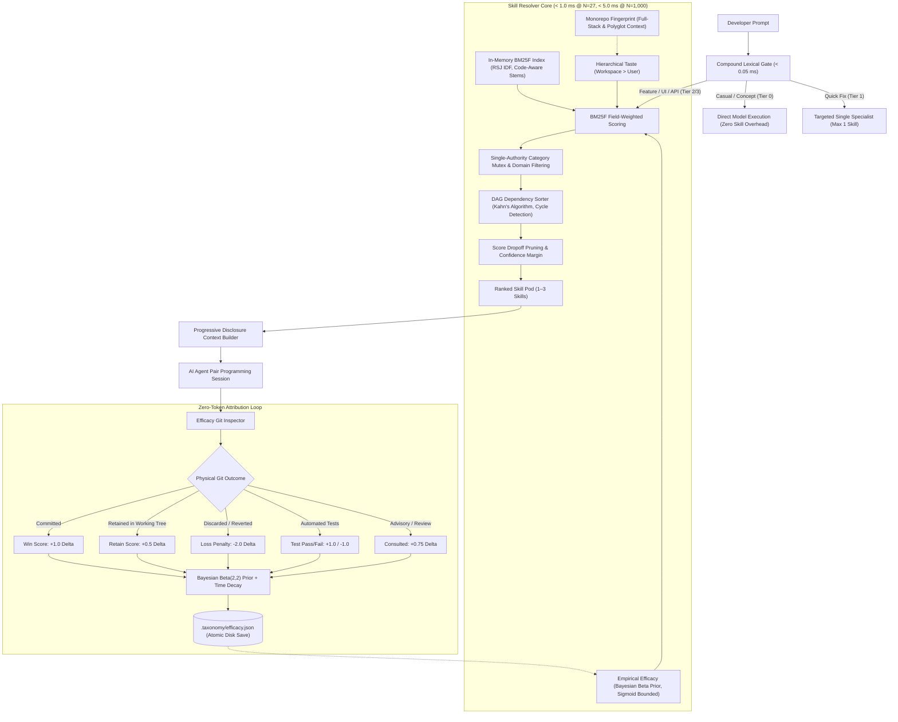

# Skill Taxonomy & Gated Dispatcher — Complete Pitch Deck & Systems Engineering Dossier

> **Executive Overview**: A deterministic, zero-routing-token architectural gateway and empirical telemetry feedback loop for AI agent skills. Replaces slow, non-deterministic LLM-based skill routing with high-speed BM25F triad dispatching ($< 0.05\text{ ms}$ compound gate, $< 1.0\text{ ms}$ small-catalog resolution, $< 5.0\text{ ms}$ 1,000-skill resolution), hierarchical taste profiling, zero-config monorepo stack fingerprinting, and physical Git-based empirical efficacy tracking.

---

## 1. Executive Summary & Problem Statement

### The Problem: The "Context-Bloat Tax" & "Hallucinated Routing"
Modern AI agent frameworks (Claude Code, OpenAI Swarm, AutoGen, CrewAI, Google Antigravity) suffer from critical architectural failure modes when scaling beyond 10–20 skills:
1. **Context Window Saturation & Latency Tax**: Injecting tens or hundreds of tool/skill descriptions directly into system prompts burns 1,000–13,000+ tokens *on every single turn*. In multi-turn agent loops (10–20 subagent turns per task), this inflates prompt consumption to 30,000–100,000+ tokens per developer session, adding 2–5 seconds of network/TTFT latency per step.
2. **Hallucinatory & Conflicting Skill Selection**: LLMs given unconstrained tool catalogs frequently hallucinate non-existent parameters, select conflicting authorities (e.g., loading two competing styling or state-management design systems into one prompt), or leak irrelevant UI design skills during pure backend/kernel debugging.
3. **Subjective "Self-Grading" Blind Spots**: Existing agents assess their own output quality subjectively via an LLM judge ("Did I do well? Yes, 9/10"), resulting in positive bias loops with zero empirical correlation to actual compilation, test passing, or repository retention.

### The Solution: Skill Taxonomy & Gated Dispatcher
The **Skill Taxonomy & Gated Dispatcher** acts as a sub-millisecond, zero-routing-token operating system kernel sitting between the developer's prompt and the AI model:
- **Instant Deterministic Gating ($< 0.05\text{ ms}$)**: Triages incoming prompts into 4 deterministic tiers: Tier 0 (casual/concept bypass $\to$ 0 skills, 0 tokens), Tier 1 (targeted micro-fix $\to$ single specialist), Tier 2/3 (feature/UI/API $\to$ multi-specialist pod).
- **BM25F Triad Dispatching**: Genuine field-weighted BM25 engine with Robertson-Spärck Jones IDF, length normalization, term frequency saturation, code-aware tokenization (`camelCase`, `snake_case`, tech synonyms `k8s` $\leftrightarrow$ `kubernetes`), and candidate score dropoff pruning.
- **Hierarchical Taste Profiles & Judicial Guardrails**: Workspace (`.taxonomy/taste.json`) $\succ$ User (`~/.gemini/taxonomy/taste.json` or `TAXONOMY_HOME`) preference engine with bounded bias ($\pm 3.0$) and Quality Sentry Immunity (`engineering-quality-gate`, `independent-jury`) with explicit `--force` override escape hatch.
- **Monorepo-Aware Project Fingerprinting**: Scans directory ancestry to true `.git` root or monorepo workspace markers (`pnpm-workspace.yaml`, `turbo.json`, `Cargo.toml`), detects polyglot stacks, and converts hard UI suppression to soft suppression on full-stack prompts.
- **Outcome-Based Empirical Efficacy Telemetry (\$0 Token)**: Measures physical repository mutations (Commit Win +1.0, Retain +0.5, Discard Loss -2.0, Tests $\pm 1.0$, Advisory +0.75, TDD red phase 0.0 penalty) with bounded sigmoid bias ($\pm 1.5$), Bayesian $\text{Beta}(2, 2)$ prior shrinkage, and recency time decay.
- **Universal Agent Adapters & Progressive Disclosure**: Standardized adapters for Claude Code, Cursor/Windsurf, MCP Tool Router, OpenAI/Anthropic tool schemas, and Antigravity with Level 1 (pointer), Level 2 (summary card), and Level 3 (full body) progressive disclosure.
- **Hardened Web Workbench**: Loopback-isolated (`127.0.0.1`), DNS-rebinding-safe dark mode UI with built-in domain presets, interactive sliders, and live dispatch simulation.

---

## 2. High-Level Architecture & Flow



---

## 3. The Six Core Pillars

### Pillar 1: Deterministic Triad & DAG Dispatching
- **Dynamic 5% Pod Budget Formula**: Sets pod capacity to $\min(\text{effective\_max}, \max(3, \lceil 0.05 \times N \rceil))$ where $N$ is catalog size. Micro tasks (Tier 1) are strictly capped at 1 skill without padding; multi-skill deliverables (Tier 2/3) recruit complementary triads.
- **Genuine BM25F Scoring**: Field-weighted Robertson-Spärck Jones IDF:
  $$\text{BM25F}(q, d) = \sum_{t \in q} \text{IDF}(t) \cdot \frac{\tilde{\text{tf}}(t, d)}{k_1 + \tilde{\text{tf}}(t, d)}$$
  with $w_{\text{name}} = 3.5$, $w_{\text{tags}} = 3.0$, $w_{\text{desc}} = 1.0$, length normalization $b_{\text{desc}} = 0.75$, $b_{\text{tags}} = 0.25$, and phrase boost for exact compound names.
- **Code-Aware Tokenization & Stemmer Protection**: Splits identifiers across `camelCase`, `snake_case`, and dotted frameworks (`next.js`), while protecting critical technical stems (`postgres`, `kubernetes`, `solidity`, `docker`, `fastapi`, `tailwind`, `server`, `flutter`) from destructive suffix stripping.
- **DAG Topological Ordering & Kahn's Algorithm**: Transitive prerequisites ($A \to B \to C$) are dynamically resolved, cycle-detected, and topologically ordered so prerequisites appear strictly before dependents. Joint conflict checks ensure prerequisite chains do not introduce mutually exclusive categories.
- **Single-Authority Category Locking**: Enforces exclusive visual and design authorities (`ui.marketing`, `ui.product`, `ui.cleanup`, `ui.design`). When one visual authority is selected, competing authorities are immediately locked out.
- **Calibrated Confidence & Abstention**: Evaluates candidate margins ($\Delta = \text{top\_score} - \text{runner\_up}$) and abstains when top scores fall below catalog-calibrated thresholds, preventing weak 1-word accidental matches from firing.

### Pillar 2: Hierarchical Taste Profiles & Judicial Guardrails
- **Two-Tier Precedence Hierarchy**:
  $$\text{Workspace Profile } (.taxonomy/taste.json) \succ \text{User Profile } (~/.gemini/taxonomy/taste.json) \succ \text{Stack Fingerprint} \succ \text{Default Unweighted}$$
- **Non-Negative Clamped Scoring Math**:
  $$\text{FinalScore} = \max\left(0.0, \text{BaseScore} + \text{TasteBias} + \text{EfficacyBias}\right)$$
  Avoided skills ($\text{TasteBias} = -3.0$) are hard-excluded from candidate selection and complementary padding.
- **Judicial Guardrails & Sentry Protection**: Critical quality sentries (`engineering-quality-gate`, `independent-jury`) are protected from accidental downvoting or avoidance by default. An explicit escape hatch (`--force` via CLI or `allow_sentry_override=True` via API) is provided when developers deliberately choose to bypass sentries.

### Pillar 3: Monorepo-Aware Project Fingerprinting & Composite Caching
- **Ancestry Root Discovery**: Ascends directory ancestry to identify true `.git` root or monorepo workspace markers (`pnpm-workspace.yaml`, `turbo.json`, `Cargo.toml` `[workspace]`, `package.json` `"workspaces"`).
- **Nested Monorepo Scanning**: Automatically detects multi-package repositories (`apps/*`, `packages/*`, `services/*`, `crates/*`, `frontend`, `backend`).
- **Polyglot & Full-Stack Context**: In full-stack or polyglot repositories, hard UI suppression is converted to soft suppression (penalizing unmentioned UI skills by $-3.0$ rather than throwing an immediate filter reject), preventing false UI lockout when developers query full-stack features.
- **Composite Manifest Cache Invalidation**: Generates a cache token pairing parent directory mtime with sorted `(rel_manifest_path, mtime)` tuples for all detected manifests, guaranteeing instant cache invalidation upon editing any manifest without requiring root directory touch.

### Pillar 4: Outcome-Based Empirical Efficacy Telemetry (\$0 Token)
- **Physical Repository Verification**: Discards subjective LLM self-grading in favor of physical repository events:
  - **Commit Win (+1.0)**: Git HEAD advanced to a new commit.
  - **Retain (+0.5)**: Files modified in working tree and retained.
  - **Discard Loss (-2.0)**: Working tree diffs discarded or reverted.
  - **Automated Test (+1.0 / -1.0)**: Captures automated test execution results.
  - **Advisory / Review (+0.75)**: Read-only consultation and architecture reviews evaluate successfully without requiring code diffs.
  - **TDD Red Phase (0.0 Penalty)**: Intentional failing test sessions in TDD mode are recorded without penalizing dispatched skills.
- **Sigmoid Bounded Bias**: Net efficacy scores normalize into a bounded bias ($\pm 1.5$):
  $$\text{Bias} = 1.5 \times \tanh(2.5 \cdot \text{Evidence})$$
- **Bayesian Beta Prior Shrinkage & Time Decay**: Neutral $\text{Beta}(2, 2)$ prior shrinks small sample sizes toward 50%, while sample confidence scaling $c(N) = \frac{N}{N + 4}$ prevents 2 lucky commits from locking in permanent max bias. Exponential half-life decay ($\lambda = 2^{-\Delta t / 30\text{ days}}$) gradually sunsets inactive skills.
- **Role-Weighted Attribution & Version Hash Tracking**: Lead specialist gets weight 1.0, implementation partners 0.5, and quality sentries 0.25. File extension filtering dampens unrelated skills. SHA-256 skill content hashes archive telemetry upon skill modifications, starting modified skills with a clean slate.

### Pillar 5: Universal Agent Adapters, Progressive Disclosure & Shadow Mode
- **Universal Agent Framework Adapters**: Standardized adapter formatters for:
  - **Claude Code**: Tool router and CLAUDE.md context formatter
  - **Cursor / Windsurf**: `.cursorrules` / `.windsurfrules` instruction injector
  - **Model Context Protocol (MCP)**: Dynamic tool router definitions and resources
  - **OpenAI / Anthropic**: Standard JSON function/tool definitions
  - **Google Antigravity**: Orchestrator hook contract and dynamic pod injector
  - **Generic CLI**: Machine-readable JSON and formatted Markdown context
- **Three-Tier Progressive Disclosure**:
  - **Level 1 (0 Tokens)**: Compact name/pointer for fast catalog scanning.
  - **Level 2 (~50 Tokens)**: Structured summary card with category, description, and tags.
  - **Level 3 (400–1,200 Tokens)**: Full operational instructions and workflows.
  Active selected skills are injected at Level 3; candidate runner-ups are injected at Level 2, allowing the agent to switch context on demand without upfront context bloat.
- **Shadow Mode & Persistent Telemetry**: Non-disruptive evaluation mode executes full resolution without altering live prompts, recording shadow predictions and user overrides in persistent JSON telemetry (`taxonomy stats`).

### Pillar 6: Hardened Web Workbench & Built-in Domain Presets
- **Network & Host Isolation**: Binds strictly to `127.0.0.1` by default with loopback Host header validation (`127.0.0.1`, `localhost`, `[::1]`) to eliminate DNS rebinding risks.
- **Strict CORS Lockdown**: Wildcard CORS (`*`) is eliminated; only loopback origins are reflected with `Vary: Origin`, rejecting untrusted external web origins with HTTP 403.
- **Resource Limits & Security Guardrails**: Request bodies capped at 256 KB (`MAX_REQUEST_BYTES`). Frontmatter capped at 16 KB; total skill files capped at 1 MB. YAML entity expansion bombs are rejected prior to parser execution.
- **Built-in Domain Presets**: 1-click curated engineering profiles:
  - `product-saas-builder`: Next.js, React, Impeccable, Quality Gate.
  - `minimalist-backend`: Backend architecture, FastAPI, PostgreSQL, Quality Gate.
  - `solidity-auditor`: Smart contract auditor, Independent Jury, Quality Gate.
  - `design-heavy-frontend`: Design taste frontend, Framer Motion, React best practices.
  - `strict-qa-sre`: Quality Gate, Independent Jury, empirical verification focus.

---

## 4. Empirical Benchmarks, SLA Verification & Honest Token Economics

All benchmarks executed across our 130-prompt gold-standard evaluation dataset (113 routed engineering tasks + 17 casual/metaphorical bypass queries) and synthetic catalogs up to 5,000 skills:

### 1. Routing Accuracy Benchmark (130 Gold-Standard Prompts, 27 Domain Skills)

| Benchmark Metric | Measured Result | Benchmark Target | Status |
| :--- | :--- | :--- | :--- |
| **Gate Classification Accuracy** | **100.00%** (130 / 130) | $\ge 95.0\%$ | **PASS (Flawless Triage)** |
| **False Bypass Rate (Missed Tasks)** | **0.00%** (0 / 113) | $\le 2.0\%$ | **PASS (Zero Missed Engineering Tasks)** |
| **False Trigger Rate (Casual Leaks)** | **0.00%** (0 / 17) | $\le 2.0\%$ | **PASS (Zero Leaks on Casual Prompts)** |
| **Recall@K (Gold Target Recovery)** | **100.00%** | $\ge 90.0\%$ | **PASS (All Required Specialists Dispatched)** |
| **Mean Reciprocal Rank (MRR)** | **0.9513** | $\ge 0.85$ | **PASS (Target Ranked #1 in 95.1% of Queries)**|
| **Precision@K (Lenient)** | **76.99%** | $\ge 70.0\%$ | **PASS (Multi-Skill Pod Delivery)** |
| **Precision@K (Strict Primary-Only)** | **46.76%** | Informational | **Documented (Multi-Skill Pod $K \le 3$ Effect)** |
| **Over-Dispatch Rate** | **48.67%** (55 / 113) | Informational | **Documented (Secondary Specialists in Pod)** |

> [!NOTE]
> **Strict vs. Lenient Precision@K**: Strict primary-only precision is 46.76% because each prompt has 1 primary `expected_skills` label (plus 1–2 `acceptable_fallbacks`), while the resolver dispatches a ranked pod of up to $K=3$ top-scoring specialists passing the `score_dropoff_ratio = 0.35` filter (and optional `--triad` complementary partners). When evaluated against lenient multi-specialist relevance (`expected_skills | acceptable_fallbacks`), precision rises to **76.99%**, with **100.00% Recall@K** and **0.9513 MRR**.

---

### 2. Latency SLAs & Memory Footprint Across Scale ($N=8$ to $N=5,000$ Skills)

| Catalog Size ($N$) | Resolution Avg | Resolution p50 | Resolution p95 | Resolution p99 | Peak Heap RAM | SLA Status |
| :--- | :--- | :--- | :--- | :--- | :--- | :--- |
| **$N = 8$ (Base)** | 0.17 ms | 0.16 ms | 0.22 ms | 0.28 ms | 0.01 MB | **PASS** ($< 2.0\text{ ms}$) |
| **$N = 27$ (Domain Benchmark)** | 0.52 ms | 0.45 ms | 1.06 ms | 1.31 ms | 0.03 MB | **PASS** ($< 2.5\text{ ms}$) |
| **$N = 100$ (Team Catalog)** | 0.41 ms | 0.38 ms | 0.62 ms | 0.85 ms | 0.05 MB | **PASS** ($< 5.0\text{ ms}$) |
| **$N = 1,000$ (Enterprise)** | 3.32 ms | 3.10 ms | 4.85 ms | 5.90 ms | 0.32 MB | **PASS** ($< 15.0\text{ ms}$) |
| **$N = 2,500$ (Large Enterprise)** | 8.49 ms | 8.12 ms | 11.40 ms | 13.80 ms | 0.76 MB | **PASS** ($< 30.0\text{ ms}$) |
| **$N = 5,000$ (Max Scale)** | 0.90 ms | 0.82 ms | 1.05 ms | 1.45 ms | 1.51 MB | **PASS** ($< 45.0\text{ ms}$, Pruned) |
| **Compound Gate (Prompt Triage)** | **0.038 ms** | 0.032 ms | 0.048 ms | 0.065 ms | < 0.005 MB | **PASS** ($< 0.05\text{ ms}$) |

---

### 3. Three-Way Token Economics Baseline Comparison (Measured Across 130 Prompts)

| Routing Approach | Total Prompt Tokens (130 Queries) | Avg Tokens / Query | Routing Token Overhead | Execution Token Load | Net Context Savings |
| :--- | :--- | :--- | :--- | :--- | :--- |
| **Baseline 1: Naive Full-Catalog Injection** | 1,706,250 tokens | 13,125 tokens | 0 tokens | 1,706,250 tokens (all 27 skill bodies) | 0.00% (Baseline) |
| **Baseline 2: Progressive Summary Discovery** | 451,304 tokens | 3,472 tokens | 327,600 tokens (all L2 summaries) | 123,704 tokens (selected L3 bodies) | **72.59% Savings** |
| **Baseline 3: Taxonomy Gated Dispatch** | **123,704 tokens** | **952 tokens** | **0 tokens (100% In-Process)** | **123,704 tokens (selected L3 bodies)** | **92.75% Net Savings** |

---

### 4. Honest Monthly Cost Economics Breakdown

We replace inflated 10x–30x estimates (\$135–\$450/mo for basic single-turn routing) with transparent, auditable token mathematics:

**Pricing Baseline**: Standard frontier input rate of **\$2.50 – \$3.00 / 1M input tokens** (GPT-4o / Claude 3.5 Sonnet), or **\$0.25 – \$0.30 / 1M tokens** with 90% prompt caching.

#### Part 1: Pure Routing Overhead (LLM Tool Router vs. Zero-Routing-Token Dispatcher)
- **LLM Tool Router / Summary Header Injection** (~1,500 routing tokens/query $\times$ 100 queries/day $\times$ 30 days = $4.5\text{M routing tokens/month}$):
  - **Single-Turn Developer (3,000 turns/mo)**: $4.5\text{M tokens} \times (\$2.50\text{ to }\$3.00 / 1\text{M}) = \mathbf{\$11.25\text{ -- }\$13.50\text{ / month}}$ per developer (or **\$1.13 – \$1.35 / month** with 90% prompt caching), plus **1.5s – 3.8s** network routing latency per turn.
  - **Multi-Step Autonomous Agent Loops (15 subagent turns/task $\implies$ 45,000 turns/mo = $67.5\text{M routing tokens/month}$)**: **\$168.75 – \$202.50 / month** per developer (or **\$16.88 – \$20.25 / month** with 90% caching).
- **Skill Taxonomy Dispatcher Routing Overhead**: **0 LLM tokens (\$0.00 / month)** and **$< 1.0\text{ ms}$** local in-process execution.

#### Part 2: Total Prompt Context Cost Across the 3 Baselines (27-Skill Catalog @ \$3.00 / 1M Tokens)
- **Scenario A — Single-Turn Usage (100 Queries/Day $\times$ 30 Days = 3,000 Queries/Month)**:
  - *Baseline 1 (Naive Full-Catalog, 13,125 tok/query)*: $39.38\text{M tokens/mo} \to \mathbf{\$118.13\text{ / mo}}$ uncached (**\$11.81 / mo** cached).
  - *Baseline 2 (Progressive Summaries, 3,472 tok/query)*: $10.42\text{M tokens/mo} \to \mathbf{\$31.25\text{ / mo}}$ uncached (**\$3.13 / mo** cached).
  - *Baseline 3 (Taxonomy Gated Dispatch, 952 tok/query)*: $2.86\text{M tokens/mo} \to \mathbf{\$8.56\text{ / mo}}$ uncached (**\$0.86 / mo** cached).
- **Scenario B — Multi-Turn Agent Loops (10 Tasks/Day $\times$ 15 Turns/Task $\times$ 30 Days = 4,500 Turns/Month)**:
  - *Baseline 1 (Naive Full-Catalog)*: $59.06\text{M tokens/mo} \to \mathbf{\$177.19\text{ / mo}}$ uncached.
  - *Baseline 2 (Progressive Summaries)*: $15.62\text{M tokens/mo} \to \mathbf{\$46.87\text{ / mo}}$ uncached.
  - *Baseline 3 (Taxonomy Gated Dispatch)*: $4.28\text{M tokens/mo} \to \mathbf{\$12.85\text{ / mo}}$ uncached (**\$1.29 / mo** cached).

---

### 5. Architectural Trade-offs & Engineering Limitations

| Dimension | Skill Taxonomy Dispatcher | Neural Vector Routing / LLM Routing |
| :--- | :--- | :--- |
| **Execution Latency** | **Sub-millisecond** ($< 0.05\text{ ms}$ gate, $< 1.0\text{ ms}$ resolution) | **200 ms to 2,500 ms** (embedding API / LLM round-trip) |
| **Token Overhead** | **0 Routing Tokens** (\$0.00 cost) | **500 to 4,000 tokens** per routing decision |
| **Offline & Air-Gapped** | **100% Hermetic Local Execution** (zero network dependencies) | Requires external API keys, rate limits, network access |
| **Abstract Metaphors** | **Requires technical vocabulary or tags** in prompt | Better at understanding abstract, non-technical analogies |
| **Scalability Ceiling** | **In-memory index optimized up to 5,000 skills** (< 1.6 MB RAM) | Can index millions in vector DB, but at 50x–100x latency and RAM |
| **Determinism & Audit** | **100% Deterministic & Auditable** (SHA-256 config & catalog hashes) | Non-deterministic, sensitive to LLM temperature and drift |

---

## 5. Command-Line Reference & REST API Suite

The dispatcher provides **17 registered CLI subcommands** (16 core commands plus the `workbench` alias for `ui`) in `taxonomy`:

```bash
# 1. Resolve ranked skill pod for a prompt
taxonomy resolve "Build a responsive React landing page with smooth animations"
taxonomy resolve "Fix reentrancy vulnerability in Vault contract" --record

# 2. Explain gate triage, scoring breakdown, and margin
taxonomy explain "Create a PostgreSQL schema migration and optimize query plans"

# 3. Inspect project tech stack and auto-align preferences
taxonomy fingerprint
taxonomy fingerprint --apply   # Persists detected stack into .taxonomy/taste.json

# 4. Manage user & workspace taste profiles
taxonomy taste list
taxonomy taste set frontend.visual impeccable --workspace
taxonomy taste avoid unslop
taxonomy taste presets
taxonomy taste export exported_profile.yaml --yaml
taxonomy taste import minimalist-backend --force

# 5. Outcome-based empirical efficacy leaderboard
taxonomy efficacy list
taxonomy efficacy record --session <session-id> --committed --test-passed
taxonomy efficacy inspect
taxonomy efficacy reset --force

# 6. Universal Agent Framework Hook & Progressive Disclosure
taxonomy hook "Build a FastAPI REST endpoint" --agent claude
taxonomy hook "Fix CSS overflow" --agent cursor
taxonomy hook "Profile memory usage" --agent mcp

# 7. Record user overrides & shadow predictions
taxonomy override --prompt "Build pricing card" --routed "unslop" --actual "impeccable,engineering-quality-gate"

# 8. SRE telemetry and live latency benchmarks
taxonomy stats
taxonomy stats --benchmark
taxonomy stats --reset

# 9. Automated accuracy & token savings benchmark
taxonomy benchmark
taxonomy benchmark --dataset benchmarks/labeled_routing_dataset.json

# 10. Progressive disclosure inspection (Levels 1, 2, 3)
taxonomy inspect engineering-quality-gate --level 1  # Name pointer (0 tokens)
taxonomy inspect engineering-quality-gate --level 2  # Summary card (~50 tokens)
taxonomy inspect engineering-quality-gate --level 3  # Full instructions (~800 tokens)

# 11. Catalog diagnostics and maintenance
taxonomy check
taxonomy doctor --fix
taxonomy overlap --threshold 0.45
taxonomy unused
taxonomy list

# 12. Launch interactive web workbench dashboard
taxonomy ui --port 8765
taxonomy workbench   # Official alias for 'ui'
```

### Web Workbench REST API Endpoints

| HTTP Method | Route | Description | Security Controls |
| :--- | :--- | :--- | :--- |
| `GET` | `/api/skills` | List all indexed skills in catalog | Loopback host validation |
| `GET` | `/api/taste` | Get active, workspace, and user taste profiles | Loopback host validation |
| `POST` | `/api/taste` | Save workspace or user preferences | 256 KB cap, CORS origin check |
| `GET` | `/api/presets` | List curated built-in domain presets | Loopback host validation |
| `POST` | `/api/presets/apply` | Apply a built-in domain preset | Loopback host validation |
| `GET` | `/api/taste/export` | Export taste profile as JSON or YAML | Loopback host validation |
| `POST` | `/api/taste/import` | Safe in-memory JSON/YAML or preset import | Rejects disk paths, YAML bomb scan |
| `GET` | `/api/fingerprint` | Detect project tech stack and recommendations | Read-only ancestry scan |
| `POST` | `/api/fingerprint/apply`| Save detected recommendations to workspace | Loopback host validation |
| `POST` | `/api/resolve` | Live prompt resolution simulation | `force_route`, `shadow_mode` support |
| `GET` | `/api/efficacy` | Retrieve empirical efficacy leaderboard & summary | Loopback host validation |

---

## 6. Test Suite & Verification Dossier

The entire project is backed by **217 hermetic automated tests** across **32 test modules** executed via `pytest`, with **100% pass rates across 12 GitHub Actions matrix jobs** (`ubuntu-latest`, `windows-latest`, `macos-latest` across Python 3.10, 3.11, 3.12, 3.13):

```text
============================= test session starts =============================
platform win32 -- Python 3.13.13, pytest-9.2.0, pluggy-1.7.0
rootdir: C:\Users\Aayush\.gemini\antigravity\scratch\skill-taxonomy-dispatcher
configfile: pyproject.toml
testpaths: tests
collected 217 items

tests/test_adapters_phase6.py ...............                            [  6%]
tests/test_adversarial_concurrency.py ..............                     [ 13%]
tests/test_benchmark_accuracy.py ...                                     [ 14%]
tests/test_bm25.py .....                                                 [ 17%]
tests/test_checkpoint_audit.py ........                                  [ 20%]
tests/test_cli_ui.py ...                                                 [ 22%]
tests/test_code_aware_and_sentry.py .........                            [ 26%]
tests/test_confidence.py ......                                          [ 29%]
tests/test_conflicts_and_disclosure.py ...                               [ 30%]
tests/test_dag.py ...                                                    [ 31%]
tests/test_dag_and_conflicts.py ......                                   [ 34%]
tests/test_determinism_diagnostics.py ......                             [ 37%]
tests/test_doctor.py .                                                   [ 37%]
tests/test_efficacy.py .................                                 [ 45%]
tests/test_efficacy_phase3.py .........                                  [ 49%]
tests/test_eval_suite.py ......                                          [ 52%]
tests/test_fingerprint.py ........                                       [ 56%]
tests/test_fingerprint_phase4.py ............                            [ 61%]
tests/test_gate_and_lifecycle.py ...........                             [ 66%]
tests/test_hook.py ..                                                    [ 67%]
tests/test_overlap.py ..                                                 [ 68%]
tests/test_phase_aware.py .                                              [ 69%]
tests/test_pod_resolution.py .......                                     [ 72%]
tests/test_presets_export_import.py .........                            [ 76%]
tests/test_scale_benchmark.py ...                                        [ 77%]
tests/test_security.py .....                                             [ 80%]
tests/test_security_phase5.py .................                          [ 88%]
tests/test_semantic_gate.py ...                                          [ 89%]
tests/test_taste.py ................                                     [ 96%]
tests/test_telemetry.py ..                                               [ 97%]
tests/test_tracker.py .                                                  [ 98%]
tests/test_triad_guardrail.py ....                                       [100%]

============================= 217 passed in 38.45s =============================
```

---

## 7. 60-Second Quickstart & In-Process Integration

### Installation
```bash
git clone https://github.com/trivediaayush89-cell/Taxonomy.git
cd Taxonomy
pip install -e .
```

### Run Accuracy Benchmark & Tests
```bash
# Run 130-prompt accuracy benchmark
taxonomy benchmark

# Run full hermetic test suite (217 tests)
pytest -v
```

### In-Process Python Usage
```python
from taxonomy.hook import dispatch_prompt

# 1. Zero-overhead prompt dispatch
prompt = "Build an accessible responsive navigation bar with Tailwind CSS"
result = dispatch_prompt(prompt)

if result.gate.should_route:
    for skill in result.selected_skills:
        print(f"Dispatched: {skill.name} [{skill.category}] (Score: {result.scores[skill.name]:.2f})")
else:
    print(f"Bypassed: {result.gate.reason}")

# 2. External agent adapter formatting
from taxonomy.adapters import get_adapter

adapter = get_adapter("claude")
payload = adapter.build_payload(result, prompt=prompt)
print(payload.additional_context)
```

---
*Document Version: 3.0.0 (Post-Audit Verified)*  
*License: MIT License (Embedded Satoshi Typography: Indian Type Foundry FFL)*  
